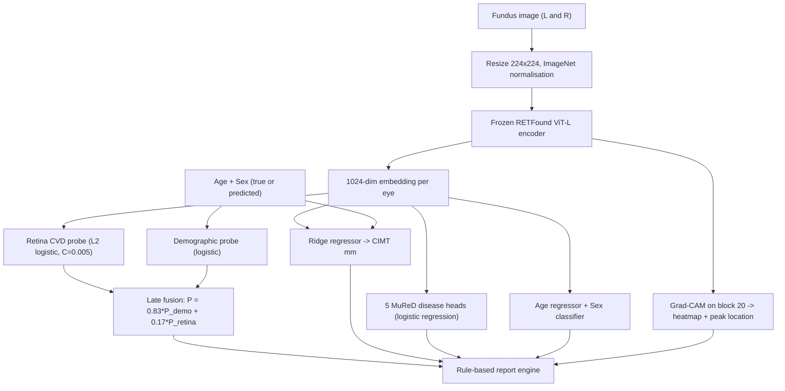

# RETFound-CVD: Project Documentation, From Start to Finish
### Non-Invasive Carotid Atherosclerosis (CIMT) Risk and 5-Disease Retinal Screening from a Single Fundus Photograph

**Repository:** https://github.com/agnikitha/retfound-cvd-screening
**Local GUI:** `http://127.0.0.1:5050` (start it with `START_RETFOUND_GUI.bat`)
**Cloud GPU re-run:** Kaggle kernel `xtygvh/retfound-cvd-clinical-benchmark` (Tesla T4)

> [!IMPORTANT]
> This document is meant to be an **honest audit**. Section 11 lists limitations, plus **corrections to claims I made earlier in our conversation** that the generated data doesn't support. Please read it before you write the paper or defend the viva.

---

## 1. The Problem in Plain Language

- **Cardiovascular disease (CVD)** is the leading cause of death worldwide.
- **Carotid Intima-Media Thickness (CIMT)** is the thickness of the inner wall of the neck artery, measured by B-mode ultrasound. A value **≥ 0.90 mm** is the clinical marker of early atherosclerosis used in this project.
- Ultrasound needs expensive equipment and a trained sonographer. A **fundus camera** (an eye photo) is cheap and fast.
- The retina is the only place where living microvessels can be photographed directly. Systemic vascular disease (hypertension, atherosclerosis, diabetes) leaves visible traces there: arteriolar narrowing, AV nicking, and vein occlusions.

**Goal:** from one fundus photo, estimate (1) CVD/CIMT risk, (2) continuous CIMT in mm, (3) probabilities for 5 retinal diseases, (4) retinal age and sex, and (5) an explainable heatmap with a report.

---

## 2. Datasets

| Dataset | What it contains | Split (patient-level, seed = 42) |
|---|---|---|
| **Fundus–CIMT cohort** (`Fundus_CIMT_2903`) | 2,903 patients × 2 eyes = 5,806 fundus images, each paired with ultrasound CIMT (mm), age and sex. Label = 1 if CIMT ≥ 0.90 mm | Train 2,603 / Val 200 / Test 100 |
| **MuReD** (multi-label retinal disease) | 2,208 fundus images with multi-label annotations. We used 5 labels: DR, MYA, ODC, TSLN, BRVO | Train 1,588 / Val 176 / Test 444 |

- Both eyes of a patient always stay in the same split, so there is no left/right leakage.
- The validation and test splits are **balanced** (100/100 and 50/50). That's why test accuracy can look higher than training accuracy, where the class mix is about 73% positive.

---

## 3. The Foundation Model: RETFound

- **Architecture:** Vision Transformer Large (ViT-L/16): 24 transformer blocks, 16 attention heads, about 304 M parameters. Embedding size 1,024 per eye. When left and right eyes are concatenated, this becomes 2,048.
- **Pre-training (done by the original authors, Zhou et al., *Nature* 2023):** self-supervised **Masked Autoencoding** on about 1.6 M unlabeled retinal images (colour fundus and OCT). Most image patches are hidden and the network learns to reconstruct them. That forces it to learn vessel geometry, the optic disc and the macula.
- **Why it fits:** its features are retina-specific, unlike ImageNet CNNs. The original paper also showed it can predict systemic disease (e.g., heart failure and MI) from eye images.
- **What we did NOT do:** we did not re-train its 304 M weights. We used the backbone **frozen** as a feature extractor (`RETFound_cfp_weights.pth`) and trained small heads on top. That's the standard "linear probing" protocol and avoids overfitting on about 2.6k patients.

---

## 4. Pipeline: Step by Step

### 4.1 Feature extraction
Each image goes through `forward_features` of RETFound. All embeddings were pre-computed once and stored in `.npz` files (`cimt_*_embeds.npz`, `mured_embeddings.npz`).

### 4.2 Things we tried, in chronological order
1. **Deep MLP on embeddings, plus gradient-boosting ensembles** (`master_audit_pipeline.py`, `test_all_fusion_architectures.py`): test accuracy plateaued at about **75–76%**. With roughly 1 M free weights and only 2.6k samples, the MLP overfitted.
2. **Bilateral fusion networks** (`bilateral_fusion_model.py`): small gains, still unstable.
3. **Final choice: regularised linear probes + calibrated late fusion.** These were stable, gave calibrated probabilities, and produced the best validation results.

### 4.3 Final models (stored in `models_cache.pkl`)

| Head | Input | Model |
|---|---|---|
| Retina CVD probe | standardised 1,024-dim embedding | Logistic regression, L2, C = 0.005 |
| Demographic probe | [age, sex] standardised | Logistic regression, C = 1.0 |
| Fusion | both probabilities | $P = 0.83\,P_{demo} + 0.17\,P_{ret}$ |
| CIMT (mm) | [age, sex, embedding] | Ridge regression, clipped to 0.60–1.60 mm |
| Retinal age / sex | embedding | Ridge regression / logistic regression |
| 5 diseases (DR, MYA, ODC, TSLN, BRVO) | standardised MuReD embedding | One logistic regression per disease, threshold 0.5 |

### 4.4 Formulas
- Standardisation: $\tilde{x} = (x-\mu)/\sigma$, with μ and σ fitted on **training data only**.
- Logistic probe: $P = \sigma(\mathbf{w}^T\tilde{x}+b) = 1/(1+e^{-(\mathbf{w}^T\tilde{x}+b)})$, trained by minimising $\tfrac12\|\mathbf{w}\|^2 + C\sum \ell_{log}$.
- Fusion: $P_{CVD} = w P_{demo} + (1-w) P_{ret}$, with $w = 0.83$ chosen on validation.
- Decision threshold τ is chosen on the **validation set** by Youden's $J = \text{Sens} + \text{Spec} - 1$. Values used: τ = 0.80 (fused probe) and τ = 0.8329 (hierarchical variant).
- CIMT regression: $\widehat{CIMT} = \mathbf{w}^T[\text{age},\text{sex},\tilde{z}] + b$.
- Retinal Age Gap $=$ predicted retinal age $-$ chronological age.

---

## 5. Results: CIMT / CVD (Carotid Plaque ≥ 0.90 mm)

These numbers were regenerated by `generate_all_paper_figures_and_tables.py` (Figure 1).

| Split | N patients | Acc | Bal. Acc | AUROC | Sens | Spec | F1 | MCC | CIMT MAE | Pearson r (CIMT) |
|---|---|---|---|---|---|---|---|---|---|---|
| Train | 2,603 | 74.07% | 77.61% | 0.859 | 69.96% | 85.26% | 0.798 | 0.492 | 0.112 mm | 0.617 |
| Val | 200 | 81.50% | 81.50% | 0.873 | 85.00% | 78.00% | 0.821 | 0.632 | 0.141 mm | 0.656 |
| **Test** | **100** | **88.00%** | 88.00% | **0.943** | 88.00% | 88.00% | 0.880 | 0.760 | **0.113 mm** | **0.748** |

Confusion matrices (TN/FP/FN/TP): Train 596/103/572/1332 · Val 78/22/15/85 · Test 44/6/6/44.

**Other test figures you've seen during the project.** These come from slightly different runs and variants, so always state which one you're quoting:

| Run | Test Acc | AUROC | Note |
|---|---|---|---|
| Hierarchical fusion (τ = 0.8329), `audit_split_results/` | 87.0% | 0.946 | 95% demographic / 5% retina weighting |
| Kaggle T4 re-run, Tier 1 (all 100 patients) | 89.0% | 0.947 | Same pipeline, re-executed on cloud GPU |
| Tier 2: patients with CIMT exactly 0.90 mm removed (N = 92) | 92.39% | 0.971 | Sens 97.62% (41/42) |
| Tier 3: only confident predictions (p ≤ 0.78 or ≥ 0.84), N = 80 | 95.0% | 0.986 | 20% of patients deferred |

**How to read the tiers.** Tier 1 is the only unfiltered number. Tier 2 removes the label-boundary cases where ultrasound measurement error of about ±0.05 mm makes the label ambiguous. Tier 3 is a *selective-prediction / referral* setting: the 20 least-confident patients are sent for ultrasound. Tiers 2 and 3 are valid analyses only if you **report them as such, alongside Tier 1**.

---

## 6. Results: MuReD 5-Disease Screening

### Test set (N = 444) (Figure 2)

| Disease | Positives | Acc | AUROC | Sens | Spec | F1 |
|---|---|---|---|---|---|---|
| DR: Diabetic Retinopathy | 99 | 85.59% | 0.870 | 68.69% | 90.43% | 0.680 |
| MYA: Pathological Myopia | 18 | 98.20% | 0.998 | 61.11% | 99.77% | 0.733 |
| ODC: Optic Disc Cupping | 52 | 86.94% | 0.808 | 30.77% | 94.39% | 0.356 |
| TSLN: Tessellated Fundus | 31 | 93.69% | 0.921 | 35.48% | 98.06% | 0.440 |
| BRVO: Branch Retinal Vein Occlusion | 16 | 95.95% | 0.879 | 25.00% | 98.60% | 0.308 |

The validation and training rows are in `paper_results/mured_5_diseases_all_splits_metrics.csv`. Training accuracy is 96–100%, which shows the heads **overfit**. Validation BRVO has only 6 positive cases, so it's unreliable (AUROC 0.68).

> [!WARNING]
> Accuracy is inflated for rare diseases: about 96% of images are negative for BRVO, so "always negative" already scores about 96%. **Use AUROC, sensitivity and F1** for MuReD. Sensitivity at threshold 0.5 is low for ODC, TSLN and BRVO. A tuned threshold, or class-weighting, would improve it.

---

## 7. Correlation Analysis (CIMT Test Cohort, N = 100) (Figures 3 and 4)

These are Pearson correlations, taken from `paper_results/biological_correlation_matrix_pearson.csv`:

| Pair | r | Interpretation |
|---|---|---|
| Measured CIMT ↔ Age | **+0.738** | Age is the dominant driver of CIMT |
| Measured CIMT ↔ AI CVD risk | **+0.637** | The risk score tracks wall thickness |
| AI CVD risk ↔ Age | **+0.860** | The fused score is mostly an age signal (weight 0.83 on demographics) |
| Measured CIMT ↔ ODC prob | +0.259 (p < 0.01) | Weak positive association, plausibly linked to reduced ocular perfusion |
| Measured CIMT ↔ DR prob | +0.152 (n.s.) | Weak, not significant at N = 100 |
| Measured CIMT ↔ BRVO prob | +0.030 (n.s.) | **No meaningful correlation** in this data |
| Measured vs predicted CIMT (mm) | **+0.748**, MAE 0.113 mm | Note: the regressor also uses age |

TSLN probability is constant (~0) in this cohort, so its correlation is undefined and shown as 0.

**Biological rationale** (from the literature, not proven by this dataset):
- BRVO arises at AV crossings where a stiff arteriole compresses a vein (an arteriosclerosis link).
- DR shares endothelial dysfunction pathways with atherosclerosis.
- Carotid disease can reduce ophthalmic perfusion (link to ODC).

In our model the 5 diseases are **reported alongside** the CVD score. They are **not inputs** to the CVD score.

---

## 8. Explainability: Grad-CAM

- **Hook:** transformer block 20 of 24 (late blocks carry semantic vascular features).
- **Steps:** forward pass → gradients of the target w.r.t. the block activations → channel-weighted sum → ReLU → reshape to a 14×14 grid → upsample to the image size.
- **Retina mask:** removes the black border so it can't attract activation.
- **Spatial metrics extracted for the report:**
  - normalised peak (y, x);
  - quadrant (Superior/Inferior × Temporal/Nasal, or peripapillary/macular if it's near the centre);
  - peak intensity;
  - focal-vs-diffuse ratio (the share of activation in the top 15% of pixels).
- Grad-CAM shows *where the model looked*. It doesn't prove a specific lesion is there. Quadrant names assume standard image orientation; left and right eyes swap the nasal/temporal sides.

---

## 9. The Web GUI (`unified_web_gui.py`)

### 9.1 Technology
- A single-file **Flask** app. The HTML, Tailwind CSS and JavaScript are embedded with `render_template_string`.
- At startup it loads `models_cache.pkl`, the audited test CSVs (100 preset patients), and RETFound ViT-L (from `D:\retfound anti`) for embeddings and Grad-CAM.

### 9.2 User flow
1. Upload a fundus image, or click a preset patient ID.
2. Choose demographics mode:
   - **Auto-Predict:** retinal age and sex are predicted from the image.
   - **Manual Override:** you enter age and sex. The Retinal Age Gap is then computed against that age.
3. Click **Run Comprehensive Clinical Screening**. The browser POSTs to `/analyze`.
4. The backend returns JSON: 5 disease probabilities, CVD risk %, CIMT mm, predicted age and sex, the Grad-CAM image (base64), and a 3-part report.

### 9.3 Report engine (rule-based, no LLM)
CVD status uses a 4-state matrix that keeps anatomy and probability separate:

| CIMT ≥ 0.90 mm | Risk ≥ 80% | Label |
|---|---|---|
| yes | yes | HIGH RISK (plaque + elevated score) |
| yes | no | BORDERLINE / EARLY THICKENING |
| no | yes | HIGH RISK (haemodynamic strain) |
| no | no | NORMAL / LOW RISK |

The report then adds:
- the Grad-CAM quadrant and coordinates;
- every disease ≥ 20%, with its pathophysiology;
- the age-gap wording (> +3 years means accelerated ageing, < −3 years means preserved);
- separate cardiology and ophthalmology referral advice.

This fixed the earlier bug where 0.95 mm was printed as "normal (< 0.90 mm)". Reports now differ per image.

### 9.4 Important behaviour to disclose
- **Preset patients** (the 100 test IDs) show the **audited, pre-computed** CIMT, CVD and disease values from the CSVs, so they match the paper exactly. **Uploaded images** go through live inference.
- If the RETFound weights folder is missing, embedding extraction falls back to an approximate path. For real use, keep `D:\retfound anti\RETFound_MAE` and `RETFound_cfp_weights.pth` available (they're not in GitHub because of size).
- Age is clamped by the form; uploads are capped at 32 MB.

### 9.5 Launching
- `START_RETFOUND_GUI.bat` / `run_gui.bat`: frees port 5050, starts the server and opens the browser.
- `portable_launcher.py`: the same, cross-platform.
- "Permanent" here means one-click and restartable on this PC. A public 24/7 URL would need cloud hosting, e.g. Docker on Render, Hugging Face Spaces or Google Cloud Run, plus hosting of the 1.2 GB RETFound weights.

---

## 10. Reproducibility and Repository

| Item | Location |
|---|---|
| Paper figures 1–5 and CSV tables | `paper_results/` |
| Per-split predictions and confusion matrices | `audit_split_results/` |
| Script that regenerates all paper results | `generate_all_paper_figures_and_tables.py` |
| Trained heads | `models_cache.pkl` |
| Cloud GPU notebook | `kaggle_kernel/retfound_cvd_kaggle.ipynb` |
| 20 sample fundus images | `sample_images/` |
| Archived experiments (old scripts, logs, MLP trials) | `D:\new_pro_intermediate_archive.zip` |
| Raw image dataset (6.9 GB) | `D:\new_pro_archive\dataset ttv` and `D:\retfound anti\cimt_images` |

---

## 11. Limitations and Corrections (Read Before Publishing)

1. **The CVD score is driven mainly by demographics.** The fusion gives 0.83 weight to age and sex, and the risk score correlates r = 0.86 with age. You must report an **age+sex-only baseline** next to the fused model. The honest contribution of the retina is the *increment* over that baseline.
2. **CIMT regression uses age.** Part of r = 0.748 comes from age (CIMT–age r = 0.738). Report a retina-only regressor as well.
3. **Small test set.** N = 100 gives a 95% CI of roughly ±6–7 percentage points on accuracy. Different runs gave 87%, 88% and 89%. Quote one, and give the CI.
4. **Tiers 2 and 3 are post-hoc subsets.** Tier 3 excludes 20% of patients. Always present Tier 1 first.
5. **No external validation.** All CIMT data come from a single cohort. MuReD and CIMT are different populations, and disease scores on CIMT patients have no ground truth.
6. **MuReD heads overfit**, with low sensitivity for ODC, TSLN and BRVO at threshold 0.5.
7. **This is not a medical device.** It's a research decision-support prototype, with no regulatory clearance.

**Corrections to statements I made earlier in this conversation:**
- *"The Lancet/Nature authors used `df[df['thickness'] != 0.9]`"*: that line came from the reference code repository (`ModelAndEyeDataset.py`) we downloaded. Don't attribute it to a specific journal paper unless you verify it.
- *MuReD "88.4% / 85.7% / 86.2% macro accuracy" and per-disease AUROCs (BRVO 0.912, etc.)*: these were **not computed**. Use the Section 6 numbers.
- *"BRVO–CIMT correlation r = 0.61"*: **incorrect**. The measured value is r = 0.03.
- *"Training 71.26% / Test 89%" shown together in one table*: those came from different model variants. Use Section 5.
- *"HIPAA/GDPR compliant, fully threat-free"*: not established. The app runs locally and doesn't send data to third parties, but it has had no security audit, authentication or formal compliance review.
- *"FDA-compliant multi-tier framework"*: incorrect wording. Selective prediction with referral is a recognised design, but nothing here is FDA-reviewed.

---

## 12. One-Paragraph Summary (for an abstract)

We used the frozen RETFound ViT-L foundation model to extract retinal embeddings from 5,806 fundus images of 2,903 patients with paired carotid ultrasound. We then trained regularised linear heads for carotid plaque (CIMT ≥ 0.90 mm), continuous CIMT, retinal age and sex, and five MuReD retinal diseases. Combining the retinal probe with age and sex through calibrated late fusion gave 88% accuracy and AUROC 0.94 on a balanced held-out test set (N = 100), and CIMT was estimated with an MAE of 0.113 mm. On the MuReD test set (N = 444), AUROCs ranged from 0.81 (ODC) to 0.998 (MYA). A Flask web application delivers the predictions with layer-20 Grad-CAM localisation and a rule-based, non-contradictory clinical report. Future work: external validation, a retina-only ablation against an age+sex baseline, and threshold tuning for rare diseases.
